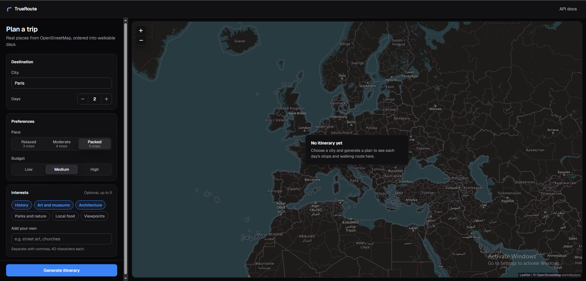
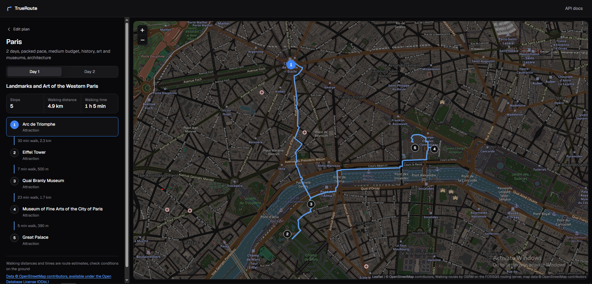
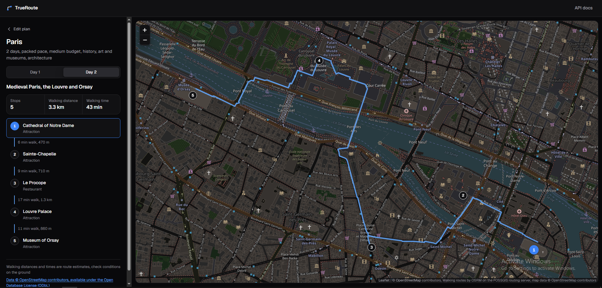

# TrueRoute AI

TrueRoute plans day-by-day city walks from real map data. You choose a city, a number of days,
a pace and a few interests; it returns an ordered plan per day with real places, a walking route
on the map and walking times between stops.

The rule behind the design: **code supplies every fact, the language model only chooses and
orders places it is given.** The model never writes a place name, coordinate, address, opening
hour, distance or price. Every value it could get wrong comes from OpenStreetMap or from
arithmetic in Python and every answer is validated before it reaches the user.





## How it works

```
request ─► Nominatim ─► Overpass ─► ranking ─► Claude ─► validation ─► walking routes ─► response
           city to      places from  top 20 +   picks and  refs back     ORS, then
           coordinates  OpenStreetMap 10 places  orders refs to places    FOSSGIS OSRM
```

1. **Geocoding.** Nominatim turns the city name into a center point and bounding box.
2. **Places.** One Overpass query fetches attractions (tourism, selected historic sites, parks)
   and restaurants around the center, within a radius derived from the city's bounding box
   (1.5 to 8 km). Notable places (with a Wikidata or Wikipedia link) come back in separate
   batches for points, buildings and multi-part buildings, so in a dense city like Paris small
   points cannot crowd out the Louvre or the Arc de Triomphe.
3. **Ranking.** OpenStreetMap has no ratings, so places are scored from the data itself: a
   Wikidata or Wikipedia link, how many languages the name exists in, how complete the tags are,
   and distance from the center. A diversity rule stops one kind of place, such as museums,
   from filling the list. The best 20 attractions and 10 restaurants get short references,
   `p1` to `p30` and a rank within their category.
4. **Planning.** Claude receives only those references, names, coordinates and ranks. The top
   attraction for each day of the trip is marked as a must-see. The answer must follow a JSON
   schema built for the request: only the allowed references, the exact number of days and a
   fixed set of stop slots, so an invented place, a missing day or too many stops cannot be
   produced.
5. **Validation.** Python checks the answer again (no repeated places, valid themes, stop limits)
   and replaces each reference with the real place. A failed check gets one retry with the
   reason. A plan that misses a must-see also gets one retry, but is accepted if the retry does
   not help, so a missing landmark never fails a request.
6. **Walking routes.** Each day is routed on foot by [openrouteservice](https://openrouteservice.org).
   If it fails, is paused after an outage, or no key is configured, the public
   [FOSSGIS OSRM server](https://routing.openstreetmap.de) is used instead. If both fail, the day
   falls back to straight-line distances and says so. Routing never fails a request.

The web page at `/` shows the plan: day tabs, stop cards and a Leaflet map that follow each other,
in a dark theme. When accounts are switched on, `/auth.html` handles sign-up, sign-in and password
reset, and the planner shows an account menu. Planning does not need an account yet.

## Accounts

Accounts are optional and switch on only when `DATABASE_URL`, both Turnstile keys and
`OTP_HMAC_KEY` are set (see [Configuration](#configuration)). Setting only some of them stops
startup.

- **Sign-up.** A username (3 to 32 letters, digits or underscores, some names reserved), an email
  and a password typed twice, behind a Cloudflare Turnstile check. A 6-digit code is emailed to
  confirm the address. A taken email gets the same answer as a new one; the real owner is told
  about the attempt by email instead.
- **Passwords.** 12 to 128 characters with uppercase, lowercase, a digit and a symbol, not
  containing the username or the start of the email, and not found in known breaches (checked
  with the [Pwned Passwords](https://haveibeenpwned.com/API/v3#PwnedPasswords) range API, which
  only ever receives the first 5 characters of the password's SHA-1 hash). Stored as argon2id
  hashes. If the breach check is unreachable, the password is accepted and a warning is logged.
- **Sign-in** with the username or email. An unconfirmed address gets a confirmation code first;
  an account with two-factor sign-in turned on gets a code by email every time. After 3 failed
  sign-ins in 15 minutes for one account or one client address, the Turnstile check is required.
- **One-time codes.** 6 digits, valid for 10 minutes, usable once, locked after 5 wrong guesses,
  stored only as an HMAC. A new code for the same account and purpose waits 60 seconds, and at
  most 5 are emailed per account and purpose per hour.
- **Password reset.** A code is emailed after a Turnstile check. The answer is the same whether
  or not the address has an account. The new password must pass the same rules and breach check.
  A successful reset signs every device out, voids all open codes, confirms the email address
  and tells the owner by email.
- **Sessions.** A random token in a `__Host-` cookie (`Secure`, `HttpOnly`, `SameSite=Lax`),
  stored only as a hash. A session ends after 7 days without use or 30 days in total. Requests
  that change state are refused when the browser reports them as coming from another site.

Account emails are printed to the server console for now, not sent. An email provider is needed
before accounts can be used by anyone else.

## Quick start

Requirements:

- Python 3.11 or newer (tested on 3.12 and 3.13)
- An [Anthropic API key](https://console.anthropic.com)
- A contact address for the OpenStreetMap services (see [Data and licences](#data-and-licences))
- Optional: a free [openrouteservice key](https://openrouteservice.org/dev/#/signup) for the
  primary walking routes

```bash
git clone https://github.com/edvt-exe/TrueRoute-AI.git
cd TrueRoute-AI
python3 -m venv .venv
source .venv/bin/activate
python -m pip install -r requirements-dev.txt
cp .env.example .env
```

Fill in `.env`. Two values are required:

```
ANTHROPIC_API_KEY=your key from the Claude Console
APP_USER_AGENT=TrueRoute-AI/0.1 (you@example.com)
```

Then start the app and open http://127.0.0.1:8000/:

```bash
uvicorn app.main:app --workers 1
```

`.env` is ignored by git. Never commit it.

To switch accounts on, start the local PostgreSQL from `docker-compose.yml` (it listens on
`127.0.0.1` only and needs `POSTGRES_PASSWORD` set in your shell), set `DATABASE_URL`,
`TURNSTILE_SITE_KEY`, `TURNSTILE_SECRET_KEY` and `OTP_HMAC_KEY` in `.env`, then create the tables:

```bash
docker compose up -d
alembic upgrade head
```

`.env.example` lists Cloudflare's published Turnstile test keys for local development. They pass
every check, so never use them on a server; the app logs a warning when they are set.

## Configuration

All settings come from `.env` in the project root. Real environment variables take precedence
over the file. Unknown keys are rejected, so a typo fails at startup instead of being ignored.
Error messages name the setting but never print its value.

| Variable | Default | Notes |
|---|---|---|
| `ANTHROPIC_API_KEY` | required | Never logged or returned |
| `APP_USER_AGENT` | required | Must name the app and give a contact; library default agents are rejected |
| `LLM_MODEL` | `claude-sonnet-5-5` | Any Claude model ID |
| `LLM_EFFORT` | `medium` | `low`, `medium` or `high` |
| `NOMINATIM_BASE_URL` | `https://nominatim.openstreetmap.org` | HTTPS only |
| `OVERPASS_BASE_URL` | `https://overpass-api.de/api` | HTTPS only |
| `ORS_API_KEY` | empty | Optional. Empty skips openrouteservice; sent only in the `Authorization` header |
| `ORS_BASE_URL` | `https://api.openrouteservice.org` | HTTPS only, must not contain the key |
| `OSRM_ENABLED` | `true` | Use FOSSGIS OSRM as the backup router |
| `OSRM_BASE_URL` | `https://routing.openstreetmap.de` | HTTPS only |
| `DEMO_ACCESS_CODE` | empty | Optional. When set, the page asks for this code; 8 to 200 printable ASCII characters, no spaces |
| `RATE_LIMIT_PER_IP_HOUR` | `5` | Itinerary requests per client address per rolling hour, 1 to 1000 |
| `DAILY_ITINERARY_CAP` | `100` | Itinerary requests for all clients per rolling 24 hours, 1 to 10000 |
| `DATABASE_URL` | empty | Optional, for accounts. Must start with `postgresql+asyncpg://`; holds the database password |
| `TURNSTILE_SITE_KEY` | empty | Optional, for accounts. Public; set together with the secret key |
| `TURNSTILE_SECRET_KEY` | empty | Optional, for accounts. Never logged or returned |
| `OTP_HMAC_KEY` | empty | Optional, for accounts. At least 32 printable characters; changing it voids every open code |
| `LOG_LEVEL` | `INFO` | The Anthropic and HTTP client loggers stay at `WARNING`, because at debug level they log request bodies |

A long random access code can be generated with:

```bash
python -c "import secrets; print(secrets.token_urlsafe(16))"
```

and an `OTP_HMAC_KEY` with:

```bash
python -c "import secrets; print(secrets.token_urlsafe(48))"
```

## API

Interactive API docs are served at `/docs`.

### `POST /api/itinerary`

```bash
curl -s -X POST http://127.0.0.1:8000/api/itinerary \
  -H "content-type: application/json" \
  -H "X-Access-Code: $DEMO_ACCESS_CODE" \
  -d '{"city": "Bucharest", "days": 2, "pace": "relaxed", "interests": ["history"]}'
```

The `X-Access-Code` header is only needed when `DEMO_ACCESS_CODE` is set.

| Field | Type | Rules |
|---|---|---|
| `city` | string | 1 to 100 characters, required |
| `days` | integer | 1 to 7, required |
| `pace` | string | `relaxed` (2 to 3 stops a day), `moderate` (3 to 4), `packed` (4 to 5); default `moderate` |
| `budget` | string | `low`, `medium`, `high`; default `medium`. A soft hint only, the data has no prices |
| `interests` | list of strings | Up to 5, each up to 40 characters |

Response, shortened to one day. The first place is real OpenStreetMap data; the second place's
ID and the route values are illustrative:

```json
{
  "itinerary": {
    "city": "Bucharest",
    "days": 1,
    "pace": "relaxed",
    "budget": "medium",
    "day_plans": [
      {
        "day": 1,
        "theme": "Old Town heritage",
        "stops": [
          {
            "order": 1,
            "place": {
              "ref": "p1",
              "osm_type": "node",
              "osm_id": 672149975,
              "name": "Stavropoleos Monastery",
              "category": "attraction",
              "coords": {"lat": 44.431803, "lon": 26.0987087},
              "address": "Strada Poștei 6"
            },
            "leg_distance_km": null,
            "leg_walk_minutes": null
          },
          {
            "order": 2,
            "place": {
              "ref": "p2",
              "osm_type": "way",
              "osm_id": 26986473,
              "name": "Old Princely Court",
              "category": "attraction",
              "coords": {"lat": 44.4303, "lon": 26.1009},
              "address": null
            },
            "leg_distance_km": 0.41,
            "leg_walk_minutes": 6
          }
        ],
        "total_distance_km": 0.41,
        "distance_source": "walking",
        "total_walk_minutes": 6,
        "route_latlon": [[44.4318, 26.09871], [44.4312, 26.0994], [44.4303, 26.1009]],
        "route_provider": "osrm"
      }
    ],
    "unused_places": 0,
    "disclaimer": "Walking distances and times are route estimates, check conditions on the ground"
  },
  "attribution": "Data © OpenStreetMap contributors, available under the Open Database License (ODbL)",
  "attribution_url": "https://www.openstreetmap.org/copyright",
  "routing_attribution": "Walking routes by OSRM on the FOSSGIS routing server, map data © OpenStreetMap contributors"
}
```

- `distance_source` is `walking` when a router drew the day, otherwise `aerial`. Aerial days have
  straight-line `leg_distance_km`, no walking minutes, an empty `route_latlon` and no
  `route_provider`.
- `route_latlon` is in latitude, longitude order, ready for Leaflet and capped at 400 points;
  every stop stays on the line.
- `routing_attribution` credits each routing service that drew one of the days and is `null`
  when every day is aerial.
- `osm_type` and `osm_id` identify the place on OpenStreetMap, for example
  `https://www.openstreetmap.org/node/672149975`.

### Errors

Every error has the same shape, with a fixed message that never contains internal details or
the submitted values:

```json
{"error": {"code": "city_not_found", "message": "city not found"}}
```

| Status | Code | Cause |
|---|---|---|
| 401 | `access_denied` | `DEMO_ACCESS_CODE` is set and the `X-Access-Code` header is missing or wrong |
| 404 | `city_not_found` | Nominatim has no match for the city |
| 403 | `cross_site_request` | A state-changing `/api` request that the browser reports as coming from another site |
| 413 | `payload_too_large` | Request body over 16 KB |
| 422 | `invalid_request` | Request body does not match the rules above |
| 422 | `not_enough_places` | Too few usable places near the city for the number of days |
| 429 | `rate_limited` | Too many requests from this address in the last hour; see `Retry-After` |
| 429 | `daily_cap_reached` | The daily cap for all clients is used up; see `Retry-After` |
| 500 | `server_misconfigured` | API key or settings rejected; details are in the server log |
| 500 | `internal_error` | Unexpected failure; the traceback is in the server log |
| 502 | `planner_failed` | The model refused, was cut off, or failed validation twice |
| 503 | `upstream_unavailable` | Nominatim, Overpass or the Claude API is down or rate limited |
| 504 | `request_timeout` | The whole request took longer than 150 seconds |

The access check and rate limits run before the body is validated, so an unauthenticated
request gets `401` and every request counts toward the limits. A wrong access code also uses
one of the hourly requests, which makes guessing as slow as planning.

### `GET /api/health`

Returns `{"status": "ok"}`. It calls no external service and is never rate limited.

### Account routes

All under `/api/auth`. Every route except `GET /captcha` answers `503 accounts_unavailable` when
accounts are off. Request bodies reject unknown fields.

| Route | Body | Answer |
|---|---|---|
| `GET /captcha` | none | `{"site_key": ...}`, `null` when accounts are off |
| `POST /signup` | `username`, `email`, `password`, `password_confirm`, `captcha_token` | `202`, `{"status": "otp_required", "challenge_id": ...}` |
| `POST /otp/verify` | `challenge_id`, `code` | `{"status": "signed_in", "username": ...}` and the session cookie |
| `POST /otp/resend` | `challenge_id` | `202`, a new `challenge_id`; the old code stops working |
| `POST /signin` | `identifier`, `password`, `captcha_token` when asked for | `signed_in` with the cookie, or `otp_required` when a code was emailed |
| `POST /password/forgot` | `email`, `captcha_token` | `202`, `otp_required` with a `challenge_id`, the same for unknown addresses |
| `POST /password/reset` | `challenge_id`, `code`, `password`, `password_confirm` | `{"status": "password_changed"}`, every session ended |
| `POST /signout` | none | `{"status": "signed_out"}`, the cookie cleared |
| `GET /me` | none | `username`, `email`, `two_factor_enabled` |
| `POST /2fa` | `enabled`, `password` | the account as from `/me` |

Account errors use the same shape as above:

| Status | Code | Cause |
|---|---|---|
| 400 | `captcha_required` | Sign-in after repeated failures without a Turnstile token |
| 400 | `captcha_failed` | The Turnstile token was rejected or was solved for another form |
| 400 | `password_breached` | The password appears in known breaches |
| 400 | `password_personal` | On reset, the password contains the username or the start of the email |
| 400 | `invalid_code` | The code is wrong, expired, used, locked or for another purpose |
| 401 | `invalid_credentials` | Wrong username, email or password |
| 401 | `not_signed_in` | `/me` or `/2fa` without a valid session |
| 409 | `username_taken` | Sign-up with a username already in use |
| 429 | `rate_limited` | Too many codes requested for this account; see `Retry-After` |
| 503 | `accounts_unavailable` | Accounts are not configured on this server |

## Deployment

- **Run one worker.** Caches, rate limits, the failed sign-in counts and the pauses after upstream
  refusals live in process memory. More workers would multiply the request rate to the public
  OpenStreetMap and routing servers beyond their policies and each would keep its own limits.
  Accounts, sessions and the code limits are in PostgreSQL and are shared already.
- **Behind a reverse proxy,** set uvicorn's `FORWARDED_ALLOW_IPS` to the proxy's address (it
  accepts networks too). Uvicorn then resolves the real client address from `X-Forwarded-For`
  before the app sees it. The app itself never reads that header, so a client cannot fake its
  address to dodge the limits. IPv6 clients are limited per `/64`, since one user usually holds a
  whole `/64`.
- **Protect a public demo** with `DEMO_ACCESS_CODE` and keep `RATE_LIMIT_PER_IP_HOUR` and
  `DAILY_ITINERARY_CAP` low. Every itinerary costs a Claude call and uses shared public services.
- **Security headers** are sent on every response: a strict Content Security Policy (scripts,
  styles and fonts only from this site, map tiles only from `tile.openstreetmap.org`),
  `Referrer-Policy: strict-origin-when-cross-origin` (the OSM tile policy needs a referrer),
  `X-Content-Type-Options: nosniff`, `X-Frame-Options: DENY` and `Cache-Control: no-store` on
  `/api`. The API docs pages skip the CSP, because Swagger UI loads its own scripts. `/auth.html`
  also allows scripts and frames from `challenges.cloudflare.com` for the Turnstile widget.
- **The API docs are public.** `/docs`, `/redoc` and `/openapi.json` are served to anyone and list
  every route, including the account routes.
- **Logs** contain request counts, timings, token use and failure reasons. They never contain API
  keys, access codes, client addresses, city names or place names.

## Measured numbers

All measured in October 2026 with `claude-sonnet-5-5` at `medium` effort.

| | Bucharest, 2 days | Paris, 2 days, packed |
|---|---|---|
| Model input tokens per call | about 2,900 | 5,511 |
| Model output tokens per call | about 110 | 147 |
| Overpass response | about 250 KB | 570 KB, 1,048 elements |
| Time, city not cached | 20 to 25 s | 42.4 s, of which 10 s waiting for an openrouteservice outage |
| Time, city cached | about 4 s | not measured |

- The Bucharest column was measured before notable places came back per element type and before
  ranks and must-see places were added to the prompt, so today's values are somewhat higher.
- A Bucharest itinerary cost about $0.007 at list prices. Paris uses about twice the input
  tokens, because its place names are longer and there are more of them.
- A plan that misses a must-see makes a second model call, so it costs about twice as much.
- Geocoding results are cached for 24 hours, places for 7 days and walking routes for 24 hours.
- The FOSSGIS router answered a 3-stop Paris day in 0.1 to 0.4 s, at a walking speed of 4.5 km/h.

## Testing

```bash
python -m pytest -q
```

954 tests, no network access and no API key needed. External services are replaced with
`httpx.MockTransport`; the API tests use FastAPI's `TestClient` with fake services.

32 of them need PostgreSQL and are skipped unless `TEST_DATABASE_URL` points at a throwaway
database. Each run drops and recreates every table in it, so never point it at a database you
want to keep. The local database from `docker-compose.yml` works for this.

The frontend has no JavaScript test runner. Instead, `tests/test_frontend.py` and
`tests/test_auth_frontend.py` check the contract between the pages and the API:

- every error code the API can return has a message on the page;
- every response field the page reads exists in the response schema;
- the form limits match the request schema;
- the page has no inline scripts or styles that the CSP would block;
- the vendored Leaflet files match the 1.9.4 release byte for byte;
- every endpoint the auth page calls exists, and each form's Turnstile action is the one its
  route checks.

Each module was also checked by mutation testing: breaking the code on purpose in many small ways
(a flipped comparison, a removed check, a wrong constant) and confirming that the tests fail every
time. Survivors led to new tests or to removing dead code. That tooling is not part of the
repository.

## Project layout

```
app/
  main.py                FastAPI app, startup wiring, error mapping, /api routes, static page
  config.py              settings from .env, logging setup
  schemas.py             data models, model-output validation, distance calculation
  security.py            access code, rate limits, security headers, cross-site check
  auth/
    routes.py            /api/auth routes
    schemas.py           account request bodies
    passwords.py         argon2id hashing
    password_policy.py   password rules
    breach.py            Pwned Passwords range check
    captcha.py           Turnstile verification, failed sign-in counts
    otp.py               one-time codes, attempt and send limits
    sessions.py          session tokens and cookie
    email.py             account email texts, development console sender
    errors.py            account error codes
  db/
    engine.py            database url check, connection pool
    models.py            users, sessions and one-time codes
    users.py             account lookup and creation
  services/
    geocoder.py          Nominatim client
    overpass_client.py   Overpass client, place ranking and filtering
    llm_agent.py         Claude client, validation retry, must-see check
    walking_routes.py    openrouteservice client, route cache, fallback order
    osrm_routes.py       FOSSGIS OSRM backup router
  utils/
    prompts.py           prompts, ranks, must-see list, per-request output schema
    throttle.py          spacing, cooldowns, sliding windows, caching, per-key locks
    http_guard.py        User-Agent and URL checks, response size limits
frontend/
  index.html, app.js, styles.css
  auth.html, auth.js, auth.css
  vendor/leaflet/        Leaflet 1.9.4 with its licence
  fonts/                 Geist variable font with its licence
migrations/              Alembic schema migrations for the account tables
tests/                   one test module per app module, plus the frontend contracts
docker-compose.yml       local PostgreSQL for development
```

## Data and licences

- **Place data** comes from [OpenStreetMap](https://www.openstreetmap.org), © OpenStreetMap
  contributors, under the [Open Database License](https://www.openstreetmap.org/copyright).
  Every response and the map show this attribution.
- **Nominatim** ([usage policy](https://operations.osmfoundation.org/policies/nominatim/)): at
  most one request per second for the whole app, an identifying User-Agent, cached results. The
  client keeps 1.1 s between requests and pauses for 60 s after a refusal.
- **Overpass** ([usage policy](https://wiki.openstreetmap.org/wiki/Overpass_API)): an identifying
  User-Agent, one request at a time, a 30 s pause after HTTP 429 or 406. Commercial use needs a
  self-hosted or paid Overpass server.
- **openrouteservice** ([terms](https://openrouteservice.org/?p=940)): free plan of
  2,000 directions a day and 40 a minute. Results are under CC BY 4.0 and shown with
  "© openrouteservice.org by HeiGIT | Map data © OpenStreetMap contributors". The client pauses
  for a minute after HTTP 429, until midnight UTC after HTTP 403 or an exhausted quota and for
  2 minutes after an outage.
- **FOSSGIS OSRM** ([about and policy](https://routing.openstreetmap.de/about.html)): at most one
  request per second, no heavy use, an identifying User-Agent. The client keeps 1.1 s between
  requests and rejects any answer that moved a stop more than 350 m to reach a path.
- **Map tiles** come from [tile.openstreetmap.org](https://operations.osmfoundation.org/policies/tiles/)
  with a referrer, as the tile policy requires.
- **Leaflet** 1.9.4, BSD 2-Clause, vendored in `frontend/vendor/leaflet` with its licence.
- **Geist** font by Vercel, SIL Open Font License, in `frontend/fonts` with its licence.

## Known limits

- **Public services can be slow or down.** When both routers fail, days fall back to
  straight-line distances; when Nominatim, Overpass or Claude fail, the request fails with a
  clear error.
- **Single process.** Caches and limits are per process, so the app must run as one worker and
  a restart clears them.
- **Account emails are not sent.** They are printed to the server console until an email
  provider is connected.
- **No cleanup job.** Used and expired one-time codes are never deleted, an expired session is
  deleted only when its cookie comes back, and unconfirmed accounts keep their username and email.
- **Account routes are limited per account, not per address.** Sign-up, sign-in and password
  reset rely on Turnstile and the per-account code limits; there is no per-address limit yet.
- **Budget is only a hint.** OpenStreetMap has no prices, so the plan cannot keep to a budget.
- **No opening hours.** A plan may include a place that is closed that day.
- **Dense cities can still fill a batch.** In central Paris the 400 notable buildings fill their
  batch and the newest ones are cut. The server logs a warning when that happens.
- **The ranking was tuned on Bucharest, Cluj-Napoca and Paris.** Other cities, especially very
  large or non-European ones, may need different caps or radius limits.
- **Restaurants** are limited to places with a website or a Wikidata link, to keep the Overpass
  response small, so good restaurants without either are missed.
- **The public OpenStreetMap and routing servers are not meant for commercial traffic.** A paid
  product needs its own or paid instances.

## Future improvements and roadmap

TrueRoute is planned to grow from a demo into a full SaaS product. Accounts exist now (see
[Accounts](#accounts)); the access code and per-address limits on planning would be replaced by
plan-based quotas per account.

### Accounts and security

- **Email delivery.** Send account emails through a transactional email provider instead of the
  console.
- **Cleanup.** A scheduled job that deletes expired codes and sessions and releases unconfirmed
  accounts after a while.
- **Rate limits per address** on the account routes, in addition to the per-account limits.
- **Account settings.** Change the password and email while signed in, and sign out on all
  devices from the account menu.
- **API docs off by default** on a public server.

### Plans and billing

- **Free tier.** Up to 3 itinerary generations per account per day.
- **Plus subscription.** Up to 20 generations per day, plus exclusive features such as saved
  trips without limit, PDF export and priority processing.
- **Secure payments.** Subscriptions handled through a PCI DSS compliant payment provider such as
  Stripe, using its hosted checkout and customer portal, so card details never touch TrueRoute's
  servers. Subscription state is updated from signed provider webhooks, never from the browser.

### Product

- **Save and export.** Save generated itineraries to the account, reopen them later and export a
  full multi-day plan as a polished PDF with each day's map, stops and walking times.
- **Open in Google Maps.** A one-click button per day that opens the day's stops, in order, as a
  walking route in Google Maps on the web or in the native app.
- **Handcrafted UI details.** Custom micro-animations for key moments such as a successful
  sign-up, sign-in or subscription purchase, designed for this product rather than taken from a
  component kit and respecting the reduced-motion setting.

### Engineering

- **Shared state.** Move caches, rate limits and quotas from process memory to Redis or similar,
  which removes the single-worker limit and keeps cached cities across restarts.
- **Own or paid map services.** Point Nominatim, Overpass and routing at self-hosted or paid
  instances, as the public services' policies require for commercial traffic. The URLs are
  already configurable.
- **Faster first response.** An uncached city takes 20 to 40 seconds. Return a job ID and stream
  progress instead of holding one request open and pre-warm the cache for popular cities.
- **Stop order computed in code.** The model groups places into days; a small exact solver could
  then order each day's 2 to 5 stops for the shortest walk.
- **Restaurants near each day's route,** fetched after the days exist and opening hours from
  OpenStreetMap once requests include travel dates.
- **Evaluation set across cities.** Saved Overpass responses for a dozen cities, so any ranking
  change shows its effect on all of them.
- **Model and cost tuning.** Compare models on a fixed set of requests scored in code (distance
  walked, retries, latency, cost) and cache the fixed part of the prompt.
- **Container, CI and observability.** A Dockerfile, a pipeline that runs the tests and an
  automated mutation testing tool on every change and per-stage metrics with request IDs.